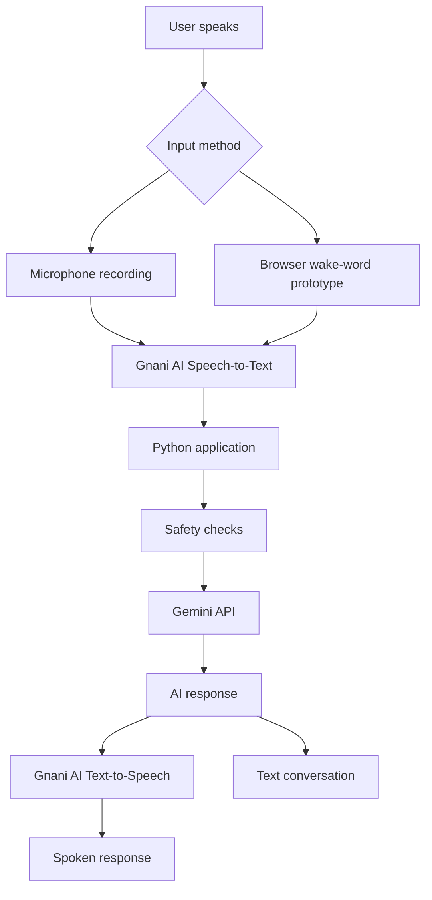

# 🎙️ Bhavi Voice Companion

### Your voice-first AI companion for listening, learning, and everyday help.

[](https://bhavi-voice-companion.onrender.com)
[](https://www.python.org/)
[](https://streamlit.io/)

**Bhavi Voice Companion** is a voice-first AI application designed to make AI assistance more natural and accessible through spoken conversations. It combines speech recognition, AI-generated responses, and speech synthesis in a single interface.

The project explores how conversational AI can support students, everyday users, and people who prefer speaking instead of typing.

**🚀 Try the live application:**  
https://bhavi-voice-companion.onrender.com

---

## ✨ Key Features

- 🎤 **Voice Interaction:** Record a spoken request through the microphone interface.
- 🗣️ **Speech-to-Text:** Uses Gnani AI speech recognition to convert speech into text.
- 🧠 **AI Conversations:** Uses the Gemini API to generate contextual responses.
- 🔊 **Text-to-Speech:** Uses Gnani AI speech synthesis to turn responses into audio.
- 🎧 **Wake-Word Prototype:** Includes browser-based voice activation for “Bhavi” or “Hey Bhavi,” subject to browser support and microphone permissions.
- 📚 **Study Buddy:** Ask questions and get help understanding academic topics.
- 💬 **Listener Mode:** Talk about concerns and receive supportive responses.
- 🌾 **Farm Helper:** Ask farming and crop-related questions.
- 🤝 **Everyday Helper:** Get assistance with general questions and daily tasks.
- 🌐 **Multilingual Speech:** The speech APIs support language options; actual language support depends on the configuration and testing.
- 🛡️ **Basic Safety Handling:** Includes basic checks for crisis-related language and displays appropriate support guidance.

## 🎯 Problem Statement

Traditional digital assistants often depend on typing or narrowly defined commands. This can make interactions less natural for users who prefer speaking or want help in a conversational format.

Bhavi Voice Companion explores a unified voice-first interface where users can speak naturally, receive AI-generated assistance, and listen to spoken responses.

## 💡 Our Solution

Bhavi combines three core stages:

1. **Listen:** Capture the user's voice and convert it into text.
2. **Understand and respond:** Send the request to the AI language model and generate a response.
3. **Speak:** Convert the response into audio for the user.

The application provides different assistance modes for learning, supportive conversation, farming questions, and everyday tasks.

## 🧰 Technology Stack

| Technology | Purpose |
|---|---|
| Python | Application logic |
| Streamlit | Interactive web interface |
| Gnani AI Prisma API | Speech-to-text |
| Gnani AI Timbre API | Text-to-speech |
| Google Gemini API | AI response generation |
| HTML and JavaScript | Browser-based wake-word component |
| Render | Web application hosting |
| Git and GitHub | Version control and source code |

## 🏗️ System Architecture



*The wake-word path depends on browser speech-recognition support and may require separate configuration from the microphone-recording path.*

## 🔄 How It Works

1. Open the live application.
2. Choose an assistance mode.
3. Record a request using the microphone, or test the browser-based voice activation feature.
4. The application processes the request through the speech and AI APIs.
5. Read the response and listen to the generated audio when available.

## 🚀 Run Locally

### Prerequisites

- Python 3.11 recommended
- Git
- A Gemini API key
- Gnani AI API credentials

### 1. Clone the repository

```bash
git clone https://github.com/Bhavitha-sri/voice-companion.git
cd voice-companion
```

### 2. Create a virtual environment

**Windows PowerShell:**

```powershell
py -3.11 -m venv venv
.\venv\Scripts\Activate.ps1
```

If PowerShell blocks activation, you can run commands using `.\venv\Scripts\python.exe` instead.

### 3. Install dependencies

```powershell
py -m pip install -r requirements.txt
```

### 4. Configure environment variables

Create a `.env` file in the project root:

```env
GNANI_API_KEY=your_gnani_api_key
LLM_API_KEY=your_gemini_api_key
LLM_MODEL=gemini-3.1-flash-lite
```

Use the model configuration supported by your code and API account.

**Security:** Never commit `.env` or publish API keys. Keep `.env` in `.gitignore`.

### 5. Start the application

```powershell
py -m streamlit run app.py
```

Open the local URL displayed in your terminal, usually:

http://localhost:8501

## ☁️ Deployment

The application is hosted on Render.

**Live URL:** https://bhavi-voice-companion.onrender.com

The free hosting plan may take additional time to respond after inactivity. Microphone and wake-word features also depend on browser permissions and supported APIs.

## 🔐 Privacy and Safety

- API credentials should be stored as environment variables.
- Conversation history is maintained in the current Streamlit session according to the current implementation.
- Basic keyword-based safety handling is not a substitute for professional crisis assessment or emergency services.
- Avoid sharing sensitive personal information with AI systems.

## 🛣️ Future Improvements

- Improve hands-free activation and repeated-command handling.
- Expand and test multilingual voice conversations.
- Improve context-aware assistance and automatic mode selection.
- Add configurable accessibility options.
- Evaluate response quality, latency, and speech-recognition accuracy.
- Explore opt-in proactive check-ins with clear consent and privacy controls.
- Strengthen safety testing and error handling.

## 👩‍💻 Project

**Developer:** Velisala Bhavitha Sri

**GitHub:** https://github.com/Bhavitha-sri

**Repository:** https://github.com/Bhavitha-sri/voice-companion

**Live Demo:** https://bhavi-voice-companion.onrender.com

---

### Built to explore more natural, accessible voice-first AI experiences.

*Bhavi Voice Companion is an experimental AI assistant and is not a replacement for qualified medical professionals or emergency services.*
